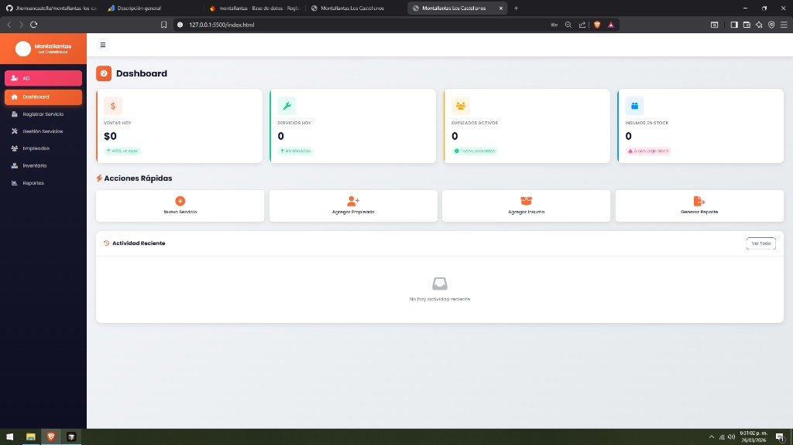
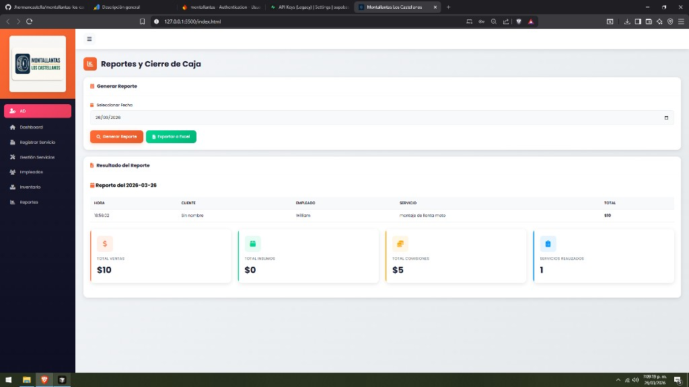

<p align="center">
  
</p>

<h1 align="center">Montallantas Los Castellanos</h1>

<p align="center">
  Sistema web para gestionar los servicios y las tareas diarias de una montallanta.
</p>

<p align="center">
  <a href="https://jhormancastella.github.io/montallantas-los-castellanos/">
    
  </a>
</p>

## 🧰 Tecnologías


## ⚙️ Funciones principales

- 🧾 Registro de servicios y cálculo de totales.
- 👥 Administración de empleados y comisiones.
- 📦 Control de inventario y venta de insumos.
- 📊 Consulta de reportes y exportación a Excel.
- 🛍️ Catálogo de servicios.

## 🖥️ Capturas de pantalla

| Panel principal | Reportes |
|:---:|:---:|
|  |  |

## 🚀 Uso local

1. Clona el repositorio:

   ```bash
   git clone https://github.com/Jhormancastella/montallantas-los-castellanos.git
   cd montallantas-los-castellanos